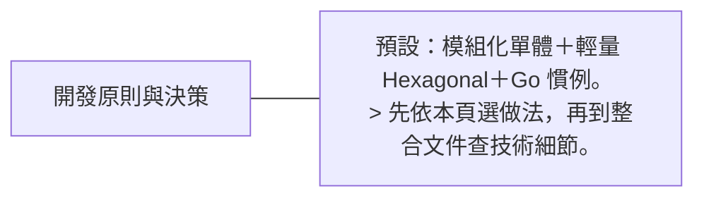
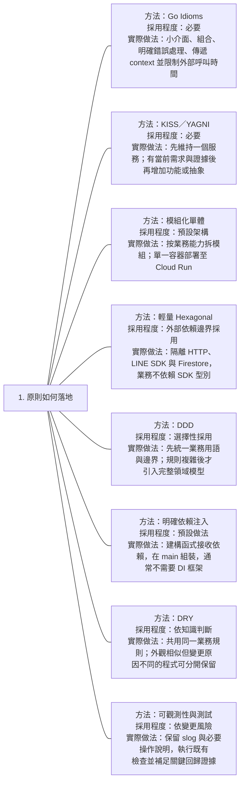
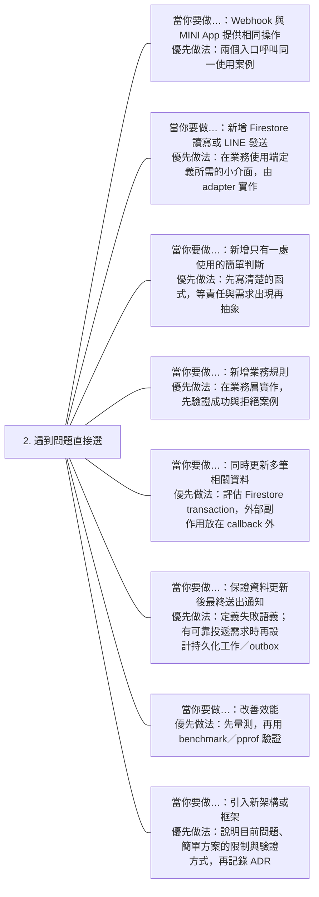
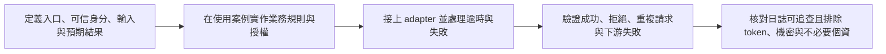
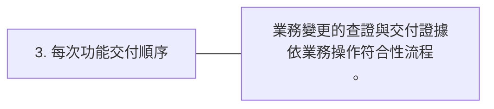
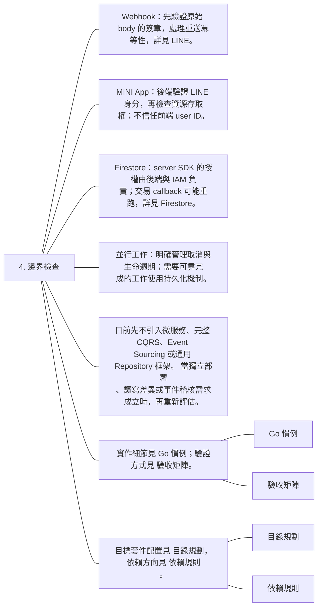
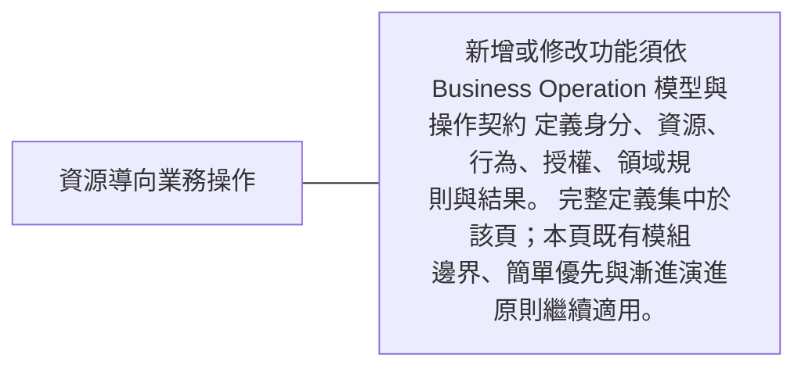

# 開發原則與決策

## 核心定位

頂尖工程師的價值，不只是寫出能運作的程式，而是**解決正確的問題，以最少必要複雜度建立可靠、可維護、可驗證的系統**。

## 六大核心原則

| 核心原則 | 關鍵問題 | 實踐標準 |
|---|---|---|
| 1. 目標正確 | 為什麼需要這個功能？ | 先定義問題、約束與成功標準 |
| 2. 模型正確 | 業務規則與資料關係是什麼？ | 建立清楚的領域模型、責任邊界與契約 |
| 3. 設計簡單 | 最少需要哪些元件？ | 避免不必要的抽象、依賴與過度設計 |
| 4. 實作可靠 | 正常與異常情境是否正確？ | 明確處理錯誤、狀態、一致性與邊界條件 |
| 5. 驗證充分 | 如何證明沒有破壞既有行為？ | 自動測試、契約檢查與持續整合 |
| 6. 持續改善 | 哪些複雜度已不再必要？ | 刪除、合併、重構並量測成效 |

## 核心思想

先確保做對的事，再用最簡單的模型實現，透過持續驗證控制風險，最後以重構降低長期成本。

**系統正確、變更容易、故障可控、成本合理，且每一次修改都能被驗證。**

## 評估指標

| 評估指標 | 衡量方式 |
|---|---|
| 定位效率 | 找到正確模組所需的工具呼叫數及時間 |
| 修改準確性 | 首次修改是否符合既有契約與業務規則 |
| 變更範圍 | 無關檔案修改數量及不必要的依賴變更 |
| 驗收品質 | 必要檢查有無遺漏、實際通過比例 |
| 上下文成本 | 文件讀取量、重複搜尋及 Token 消耗 |
| 維護成本 | 重複規則、失效引用與文件同步負擔 |

## 決策準則

**正確的問題 → 正確的模型 → 最簡單的設計 → 可靠的實作 → 可驗證的結果 → 持續降低複雜度。**

技術選擇應以正確性、效益、風險、可逆性及長期維護成本為依據，而非以技術新穎程度或抽象層數為標準。

## 任務執行與交付

1. **定義成功標準。** 實作前確認問題、受影響的流程與可觀察的驗收條件。對會改變業務行為的歧義，先查規格與實作，再確認仍缺少的決策。
2. **釐清領域模型。** 涉及業務規則或資料時，先確認資料關係、規則的責任邊界、必須維持的條件及允許的狀態轉換。沿用適用的既有模型。
3. **採用最簡單的可行設計。** 優先重用現有元件。新增抽象、依賴或服務前，說明具體需求與現有做法的限制。
4. **處理失敗與邊界。** 核對正常、無效輸入與失敗路徑。若涉及重試、併發或部分成功，確認資料狀態與恢復方式。
5. **用證據驗收。** 執行與變更風險相符的既有測試和適用的 CI 檢查。既有測試若無法捕捉本次可能造成的具體回歸，使用現有框架補上針對性的案例。
6. **降低維護成本。** 在任務範圍內刪除已無用途的程式，或合併可安全移除的重複。以效能或成本為理由重構時，先量測基線，再以相同條件比較結果。

## 3. 每次功能交付順序

開發與維運指引

